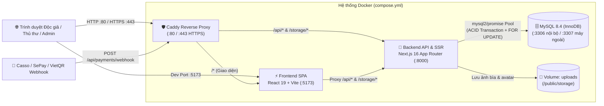
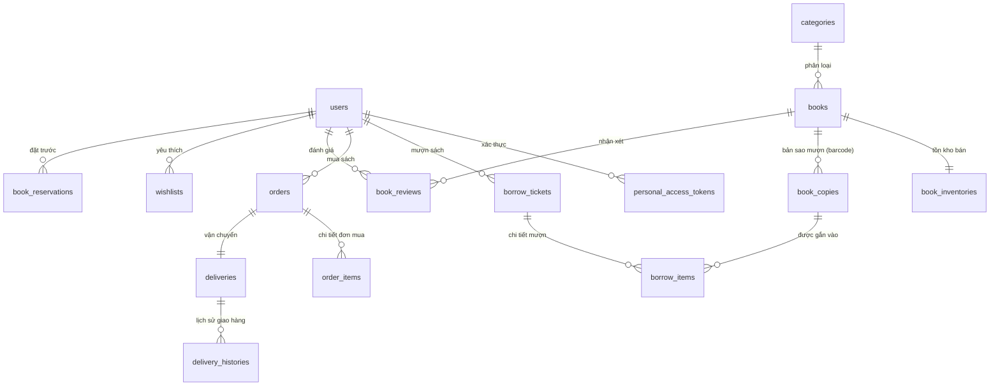

# 🏛️ CẤU TRÚC HỆ THỐNG — THƯ VIỆN TRI THỨC SỐ 4.0 (CHUYÊN ĐỀ 1)

Tài liệu này mô tả chi tiết **kiến trúc tổng thể, cây thư mục mã nguồn, thiết kế cơ sở dữ liệu (MySQL InnoDB), danh mục API (Next.js App Router), phân hệ giao diện (React 19) và luồng nghiệp vụ cốt lõi** của dự án.

---

## 1. Kiến trúc Tổng thể (System Architecture)

Hệ thống được đóng gói hoàn toàn bằng **Docker Compose** với 4 dịch vụ (containers) giao tiếp qua mạng nội bộ Docker:



### Công nghệ sử dụng (Tech Stack)
| Tầng (Layer) | Công nghệ | Vai trò chính |
| :--- | :--- | :--- |
| **Reverse Proxy** | **Caddy 2 Alpine** | Cổng giao tiếp `:80` / `:443`, tự động cấp SSL Let's Encrypt, nén `zstd/gzip`, định tuyến `/api/*`, `/storage/*` và `/*`. |
| **Frontend (SPA)** | **React 19 + Vite + Tailwind CSS + Lucide Icons** | Giao diện người dùng tốc độ cao, tích hợp `React.lazy` code-splitting, debounce tìm kiếm (`300ms`), đọc thử E-Book và AI Chatbot. |
| **Backend (API)** | **Next.js 16 (App Router) + Node.js 22** | Cung cấp 26 RESTful API endpoints (`/api/**`), xác thực Bearer Token + RBAC (`reader`, `librarian`, `admin`), xuất báo cáo CSV và VietQR Webhook. |
| **Database** | **MySQL 8.4 (`ENGINE=InnoDB`)** | Lưu trữ dữ liệu quan hệ, đảm bảo toàn vẹn giao dịch (`BEGIN...COMMIT/ROLLBACK`), khóa dòng (`SELECT ... FOR UPDATE`) và Composite Indexes. |

---

## 2. Cây Thư mục Dự án (Directory Structure)

```text
chuyende1/
├── compose.yml                     # Cấu hình Docker Compose (db, backend, frontend, proxy)
├── Caddyfile                       # Cấu hình Reverse Proxy (:80 localhost & domain HTTPS)
├── Makefile                        # Các lệnh tắt: make up, make down, make logs, make export-db, make sync-ui
├── .env / .env.example             # Biến môi trường hệ thống (DB, cổng, khóa bảo mật)
├── CAU_TRUC_HE_THONG.md            # Tài liệu kiến trúc & cấu trúc hệ thống
├── README.md                       # Hướng dẫn cài đặt và triển khai (Local & Azure VM)
│
├── docker/
│   └── mysql/
│       └── init.sql                # Schema MySQL 8.4 (InnoDB) + Dữ liệu mẫu khởi tạo tự động
│
├── scripts/
│   ├── sync-ui.mjs                 # Script đồng bộ tự động UI từ frontend/ sang frontend-next/ (UTF-8)
│   └── azure-deploy.sh             # Script hỗ trợ triển khai nhanh lên máy ảo Ubuntu Azure
│
├── frontend/                       # [FRONTEND SPA] React 19 + Vite (Cổng 5173)
│   ├── Dockerfile                  # Đóng gói container Frontend (node:22-alpine)
│   ├── vite.config.js              # Cấu hình Vite dev server & proxy (/api, /storage -> :8000)
│   └── src/
│       ├── main.jsx                # Điểm khởi chạy ứng dụng React
│       ├── App.jsx                 # Component gốc: điều hướng Catalog / Thủ thư / Admin, Lọc, Sắp xếp, Phân trang
│       ├── api.js                  # Cấu hình Axios instance + tự động đính kèm Bearer Token
│       ├── index.css               # Hệ thống Design Tokens, Glassmorphism & Animation CSS
│       └── components/             # 25 Components giao diện chức năng (xem chi tiết tại Mục 5)
│
└── frontend-next/                  # [BACKEND API & FULLSTACK] Next.js 16 App Router (Cổng 8000)
    ├── Dockerfile                  # Đóng gói container Backend (node:22-alpine)
    ├── next.config.mjs             # Cấu hình Next.js & CORS / Static Storage
    ├── scripts/
    │   └── export-db.mjs           # Công cụ xuất trực tiếp MySQL đang chạy ra file docker/mysql/init.sql
    ├── public/
    │   └── storage/                # Lưu trữ file tải lên (covers/ ảnh bìa sách, avatars/ ảnh đại diện)
    └── src/
        ├── lib/                    # Tầng lõi dùng chung cho toàn bộ API Backend
        │   ├── db.js               # MySQL Connection Pool, withTransaction(), HttpError, ensureInnoDB() & Indexes
        │   ├── auth.js             # Tạo/kiểm tra Token (hạn 7 ngày), requireAuth(), requireRole() RBAC
        │   └── helpers.js          # Hydrate dữ liệu (hydrateBooks, hydrateBorrowTickets, hydrateOrders), upload ảnh an toàn
        ├── components/             # Bản đồng bộ UI (tự động cập nhật qua scripts/sync-ui.mjs)
        └── app/
            ├── page.js             # Trang chủ Next.js
            └── api/                # 26 RESTful API Route Handlers (xem chi tiết tại Mục 4)
```

---

## 3. Cấu trúc Cơ sở dữ liệu (Database Schema — MySQL 8.4 InnoDB)

Toàn bộ các bảng trong [docker/mysql/init.sql](file:///e:/Chuyende1/Đồ%20Án/chuyende1/docker/mysql/init.sql) sử dụng **`ENGINE=InnoDB`** để hỗ trợ khóa ngoại, khóa dòng (`ROW LOCK`) và giao dịch ACID:



### Bảng dữ liệu cốt lõi
| Nhóm nghiệp vụ | Tên bảng | Mô tả chức năng & Trường quan trọng |
| :--- | :--- | :--- |
| **1. Người dùng & Phân quyền** | `users` | Lưu tài khoản với `role` (`reader`, `librarian`, `admin`), `status` (`active`, `locked`), `phone`, `address`, `avatar`. |
| | `personal_access_tokens` | Lưu SHA-256 hash của Bearer Token, thời hạn `expires_at` (7 ngày) và `last_used_at`. |
| **2. Kho sách & Danh mục** | `categories` | Danh mục thể loại sách (`name`, `slug`, `description`). |
| | `books` | Thông tin đầu sách (`title`, `author`, `isbn`, `publisher`, `publish_year`, `sale_price`, `is_borrowable`, `is_salable`). |
| | `book_copies` | Từng cuốn sách vật lý dùng để cho mượn, quản lý theo mã vạch `barcode` (`BC-1-001`) và `status` (`available`, `borrowed`, `lost`). |
| | `book_inventories` | Quản lý tồn kho sách bán mới (`stock_quantity`, `reserved_quantity`). |
| **3. Mượn trả & Đặt trước** | `borrow_tickets` | Phiếu mượn sách (`ticket_code`, `reader_id`, `librarian_id`, `borrow_date`, `due_date`, `returned_date`, `renewed_count`, `total_late_fee`, `status`). |
| | `borrow_items` | Chi tiết từng bản sao sách (`book_copy_id`) nằm trong phiếu mượn và phí phạt tương ứng (`late_fee`). |
| | `book_reservations` | Hàng đợi đặt trước đầu sách khi hết bản sao khả dụng (`waiting`, `notified`, `cancelled`, `fulfilled`). |
| **4. Mua sách & Vận chuyển** | `orders` | Đơn đặt mua sách (`order_number`, `reader_id`, `total_amount`, `shipping_fee`, `payment_status`: `pending`/`paid`/`failed`, `order_status`). |
| | `order_items` | Các đầu sách, số lượng (`quantity`), đơn giá (`unit_price`) và thành tiền (`subtotal`) trong đơn hàng. |
| | `deliveries` & `delivery_histories` | Theo dõi mã vận đơn (`tracking_code`), đơn vị vận chuyển (`carrier`), trạng thái (`pending` → `picking` → `shipping` → `delivered`) và lịch sử hành trình. |
| **5. Thanh toán & Hệ thống** | `payments` | Giao dịch thanh toán chuyển khoản VietQR (`transaction_code`, `payable_type`, `payable_id`, `amount`, `status`). |
| | `notification_logs` | Nhật ký thông báo & email tự động gửi cho độc giả (`borrow_reminder`, `overdue_notice`, `reservation_ready`, `payment_confirmed`). |
| | `system_configs` | Tham số cấu hình động của hệ thống (số ngày mượn tối đa, số sách mượn tối đa, đơn giá phạt trễ hạn/ngày). |

---

## 4. Danh mục API Backend (`frontend-next/src/app/api/**`)

Hệ thống bao gồm **26 Route Handlers** được bảo vệ bởi [`requireAuth`](file:///e:/Chuyende1/Đồ%20Án/chuyende1/frontend-next/src/lib/auth.js#L69-L79) và [`requireRole`](file:///e:/Chuyende1/Đồ%20Án/chuyende1/frontend-next/src/lib/auth.js#L81-L97):

### 4.1. Xác thực & Hồ sơ cá nhân (`/api/auth/*`, `/api/profile`)
- `POST /api/auth/register` — Đăng ký tài khoản độc giả mới ([route.js](file:///e:/Chuyende1/Đồ%20Án/chuyende1/frontend-next/src/app/api/auth/register/route.js)).
- `POST /api/auth/login` — Đăng nhập, kiểm tra khóa tài khoản và cấp Bearer Token 7 ngày ([route.js](file:///e:/Chuyende1/Đồ%20Án/chuyende1/frontend-next/src/app/api/auth/login/route.js)).
- `POST /api/auth/logout` — Thu hồi token hiện tại ([route.js](file:///e:/Chuyende1/Đồ%20Án/chuyende1/frontend-next/src/app/api/auth/logout/route.js)).
- `GET /api/auth/me` — Lấy thông tin người dùng đang đăng nhập ([route.js](file:///e:/Chuyende1/Đồ%20Án/chuyende1/frontend-next/src/app/api/auth/me/route.js)).
- `POST /api/profile` — Cập nhật hồ sơ cá nhân, đổi mật khẩu và tải ảnh đại diện ([route.js](file:///e:/Chuyende1/Đồ%20Án/chuyende1/frontend-next/src/app/api/profile/route.js)).

### 4.2. Kho sách, Danh mục, Đánh giá & Yêu thích
- `GET | POST /api/books` — Tìm kiếm, lọc theo `availability` (`borrowable`/`salable`), sắp xếp (`newest`, `price_asc`, `price_desc`, `year_desc`, `title_asc`), phân trang; thêm sách mới kèm Batch Insert bản sao ([route.js](file:///e:/Chuyende1/Đồ%20Án/chuyende1/frontend-next/src/app/api/books/route.js)).
- `GET | PUT | DELETE /api/books/[id]` — Xem chi tiết sách, cập nhật thông tin/tồn kho trong Transaction hoặc xóa sách ([route.js](file:///e:/Chuyende1/Đồ%20Án/chuyende1/frontend-next/src/app/api/books/%5Bid%5D/route.js)).
- `GET | POST /api/categories` & `DELETE /api/categories/[id]` — Quản lý danh mục thể loại sách ([route.js](file:///e:/Chuyende1/Đồ%20Án/chuyende1/frontend-next/src/app/api/categories/route.js)).
- `GET | POST /api/books/[id]/reviews` — Xem và gửi đánh giá sao + nhận xét cho đầu sách ([route.js](file:///e:/Chuyende1/Đồ%20Án/chuyende1/frontend-next/src/app/api/books/%5Bid%5D/reviews/route.js)).
- `GET /api/wishlist` & `POST /api/wishlist/[bookId]/toggle` — Quản lý tủ sách yêu thích của độc giả ([route.js](file:///e:/Chuyende1/Đồ%20Án/chuyende1/frontend-next/src/app/api/wishlist/route.js)).

### 4.3. Nghiệp vụ Mượn trả & Đặt trước sách
- `GET | POST /api/borrow-tickets` — Danh sách phiếu mượn (phân quyền theo vai trò); tạo phiếu mượn mới với khóa dòng `FOR UPDATE` chống mượn trùng bản sao ([route.js](file:///e:/Chuyende1/Đồ%20Án/chuyende1/frontend-next/src/app/api/borrow-tickets/route.js)).
- `POST /api/borrow-tickets/[id]/approve` — Thủ thư duyệt xuất kho sách cho phiếu mượn `pending` ([route.js](file:///e:/Chuyende1/Đồ%20Án/chuyende1/frontend-next/src/app/api/borrow-tickets/%5Bid%5D/approve/route.js)).
- `POST /api/borrow-tickets/[id]/renew` — Độc giả tự gia hạn phiếu mượn trực tuyến 01 lần (+7 ngày) ([route.js](file:///e:/Chuyende1/Đồ%20Án/chuyende1/frontend-next/src/app/api/borrow-tickets/%5Bid%5D/renew/route.js)).
- `POST /api/borrow-tickets/[id]/return` — Thủ thư xác nhận trả sách, tự động tính phí phạt quá hạn và tự động thông báo cho người đặt trước kế tiếp ([route.js](file:///e:/Chuyende1/Đồ%20Án/chuyende1/frontend-next/src/app/api/borrow-tickets/%5Bid%5D/return/route.js)).
- `GET | POST /api/reservations` & `DELETE /api/reservations/[id]` — Đặt trước sách khi hết bản sao mượn ([route.js](file:///e:/Chuyende1/Đồ%20Án/chuyende1/frontend-next/src/app/api/reservations/route.js)).

### 4.4. Mua sách, Vận chuyển & Thanh toán VietQR
- `GET | POST /api/orders` — Đặt mua sách mới (kiểm tra & giữ chỗ tồn kho `reserved_quantity` bằng `FOR UPDATE`) ([route.js](file:///e:/Chuyende1/Đồ%20Án/chuyende1/frontend-next/src/app/api/orders/route.js)).
- `PUT /api/orders/[id]/status` — Thủ thư cập nhật trạng thái đơn hàng & vận đơn (`picking`, `shipping`, `delivered`, `cancelled`) ([route.js](file:///e:/Chuyende1/Đồ%20Án/chuyende1/frontend-next/src/app/api/orders/%5Bid%5D/status/route.js)).
- `GET /api/deliveries/track/[orderCode]` — Tra cứu hành trình đơn hàng theo mã đơn ([route.js](file:///e:/Chuyende1/Đồ%20Án/chuyende1/frontend-next/src/app/api/deliveries/track/%5BorderCode%5D/route.js)).
- `POST /api/payments/create` & `POST /api/payments/confirm` — Khởi tạo mã QR VietQR và xác nhận chuyển khoản ([route.js](file:///e:/Chuyende1/Đồ%20Án/chuyende1/frontend-next/src/app/api/payments/create/route.js)).
- `POST /api/payments/webhook` — **Webhook tự động (Casso/SePay/VietQR)** đối soát nội dung chuyển khoản `TVS...`, tự động gạch nợ phí phạt hoặc xác nhận đơn hàng 24/7 ([route.js](file:///e:/Chuyende1/Đồ%20Án/chuyende1/frontend-next/src/app/api/payments/webhook/route.js)).

### 4.5. Trợ lý AI & Thông báo
- `POST /api/ai/chat` — Trợ lý AI Thư viện thông minh: tư vấn sách theo chủ đề/tâm trạng/ngân sách, tra cứu trực tiếp tồn kho thực tế từ CSDL và kiểm tra phiếu mượn của độc giả đang đăng nhập ([route.js](file:///e:/Chuyende1/Đồ%20Án/chuyende1/frontend-next/src/app/api/ai/chat/route.js)).
- `GET /api/notifications/my-emails`, `GET /api/notifications/unread-count`, `POST /api/notifications/send` — Hệ thống hộp thư thông báo tự động & gửi thông báo từ Thủ thư/Admin ([route.js](file:///e:/Chuyende1/Đồ%20Án/chuyende1/frontend-next/src/app/api/notifications/send/route.js)).

### 4.6. Quản trị Hệ thống (Admin & Báo cáo)
- `GET | POST /api/admin/users`, `PUT /api/admin/users/[id]/role`, `PUT /api/admin/users/[id]/status`, `POST /api/admin/users/[id]/reset-password`, `DELETE /api/admin/users/[id]` — Quản lý tài khoản và phân quyền RBAC ([route.js](file:///e:/Chuyende1/Đồ%20Án/chuyende1/frontend-next/src/app/api/admin/users/route.js)).
- `GET /api/admin/monthly-stats` — Thống kê doanh thu, lượt mượn, đơn mua 6 tháng gần nhất và danh sách độc giả nợ phí phạt ([route.js](file:///e:/Chuyende1/Đồ%20Án/chuyende1/frontend-next/src/app/api/admin/monthly-stats/route.js)).
- `GET /api/admin/export-csv` — Xuất báo cáo CSV tiếng Việt có BOM UTF-8 theo 3 chế độ: `?type=orders`, `?type=borrows`, `?type=books` ([route.js](file:///e:/Chuyende1/Đồ%20Án/chuyende1/frontend-next/src/app/api/admin/export-csv/route.js)).
- `GET | POST /api/admin/system-configs` & `POST /api/admin/trigger-schedule` — Cấu hình tham số hệ thống và kích hoạt tiến trình quét phiếu mượn quá hạn ([route.js](file:///e:/Chuyende1/Đồ%20Án/chuyende1/frontend-next/src/app/api/admin/trigger-schedule/route.js)).

---

## 5. Cấu trúc Phân hệ Giao diện (`frontend/src/components/`)

| Phân hệ | Component | Chức năng chính |
| :--- | :--- | :--- |
| **Khung ứng dụng & Xác thực** | [`App.jsx`](file:///e:/Chuyende1/Đồ%20Án/chuyende1/frontend/src/App.jsx) | Quản lý trạng thái toàn cục, bộ lọc tình trạng sách, sắp xếp, phân trang và điều hướng tab theo quyền. |
| | [`Navbar.jsx`](file:///e:/Chuyende1/Đồ%20Án/chuyende1/frontend/src/components/Navbar.jsx) | Thanh điều hướng thông minh hiển thị badge giỏ hàng, thông báo chưa đọc và menu theo vai trò. |
| | [`LoginGate.jsx`](file:///e:/Chuyende1/Đồ%20Án/chuyende1/frontend/src/components/LoginGate.jsx) & [`AuthModal.jsx`](file:///e:/Chuyende1/Đồ%20Án/chuyende1/frontend/src/components/AuthModal.jsx) | Cổng đăng nhập/đăng ký nhanh có tích hợp nút chọn nhanh tài khoản Demo (Admin, Thủ thư, Độc giả). |
| **Trải nghiệm Độc giả** | [`BookCard.jsx`](file:///e:/Chuyende1/Đồ%20Án/chuyende1/frontend/src/components/BookCard.jsx) | Thẻ hiển thị sách với lazy-loading ảnh, số lượng bản sao mượn/kho bán, nút yêu thích, mượn và thêm giỏ hàng. |
| | [`BookDetailModal.jsx`](file:///e:/Chuyende1/Đồ%20Án/chuyende1/frontend/src/components/BookDetailModal.jsx) | Chi tiết sách, đánh giá 5 sao, đặt trước khi hết sách và **Trình đọc thử E-Book (3 trang trích dẫn, đổi màu nền Sáng/Sepia/Tối & cỡ chữ)**. |
| | [`AIChatWidget.jsx`](file:///e:/Chuyende1/Đồ%20Án/chuyende1/frontend/src/components/AIChatWidget.jsx) | Bong bóng chat AI tư vấn sách trực tuyến, hiển thị thẻ sách gợi ý có thể bấm để mở chi tiết ngay. |
| | [`MyBorrowsModal.jsx`](file:///e:/Chuyende1/Đồ%20Án/chuyende1/frontend/src/components/MyBorrowsModal.jsx) | Quản lý lịch sử phiếu mượn, gia hạn trực tuyến, xem hàng đợi đặt trước và thanh toán phí phạt. |
| | [`CartModal.jsx`](file:///e:/Chuyende1/Đồ%20Án/chuyende1/frontend/src/components/CartModal.jsx) & [`DeliveryModal.jsx`](file:///e:/Chuyende1/Đồ%20Án/chuyende1/frontend/src/components/DeliveryModal.jsx) | Giỏ hàng đặt mua sách mới và tra cứu tiến trình vận chuyển đơn hàng trực tuyến. |
| | [`BankPaymentModal.jsx`](file:///e:/Chuyende1/Đồ%20Án/chuyende1/frontend/src/components/BankPaymentModal.jsx) | Hiển thị mã QR chuyển khoản VietQR động kèm nút **Tự động đối soát VietQR Webhook tức thì**. |
| | [`DigitalLibraryCardModal.jsx`](file:///e:/Chuyende1/Đồ%20Án/chuyende1/frontend/src/components/DigitalLibraryCardModal.jsx) | Thẻ thư viện số cá nhân tích hợp mã QR & Barcode định danh độc giả. |
| **Phân hệ Thủ thư** | [`LibrarianView.jsx`](file:///e:/Chuyende1/Đồ%20Án/chuyende1/frontend/src/components/LibrarianView.jsx) | Duyệt phiếu mượn, quét mã vạch trả sách, cập nhật trạng thái đơn mua/vận chuyển, duyệt thanh toán VietQR và sửa/xóa sách. |
| **Phân hệ Quản trị viên** | [`AdminView.jsx`](file:///e:/Chuyende1/Đồ%20Án/chuyende1/frontend/src/components/AdminView.jsx) | Quản lý người dùng RBAC, **Biểu đồ cột trực quan 6 tháng**, xuất 3 loại báo cáo CSV (`orders`, `borrows`, `books`), cấu hình hạn mượn/phí phạt và chạy tiến trình kiểm tra quá hạn. |
